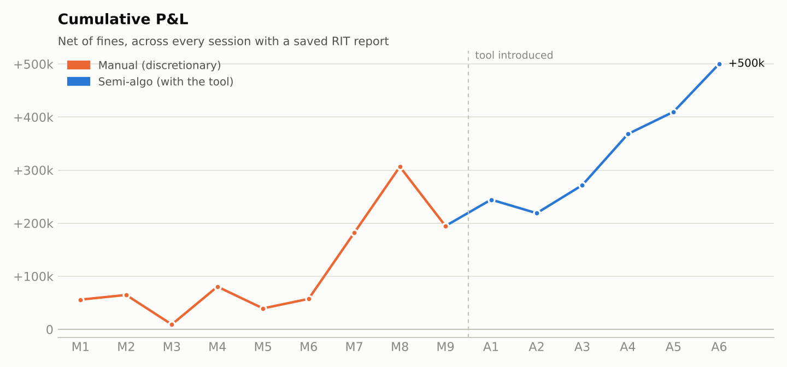
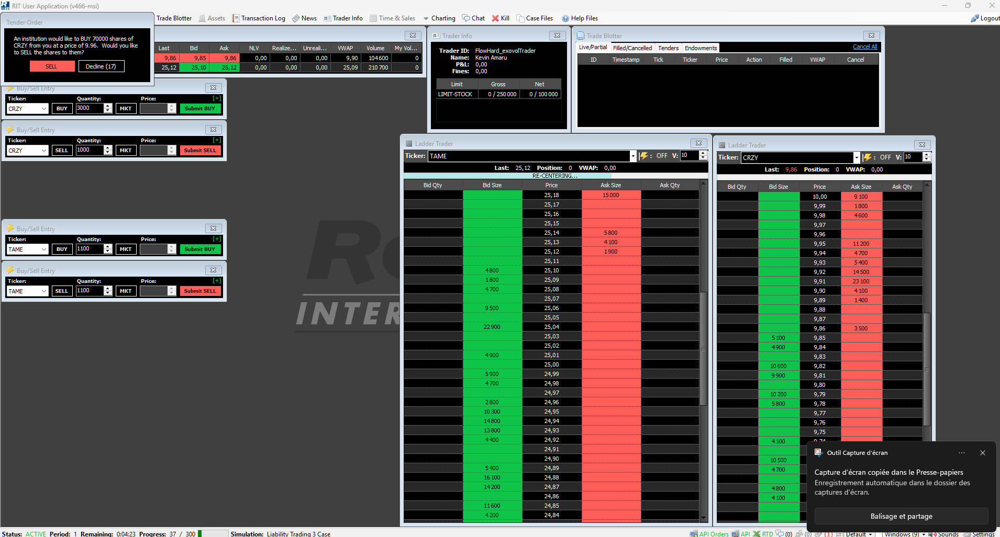
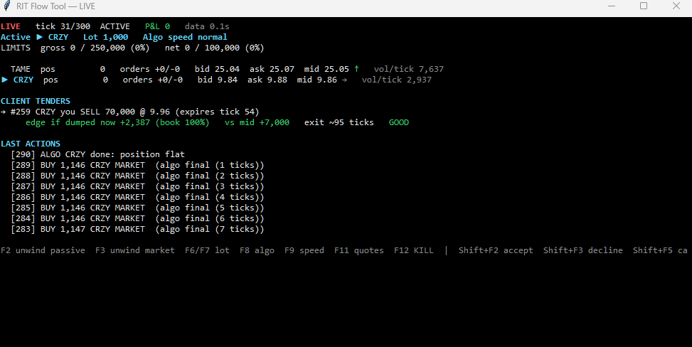
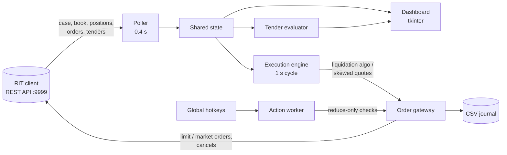
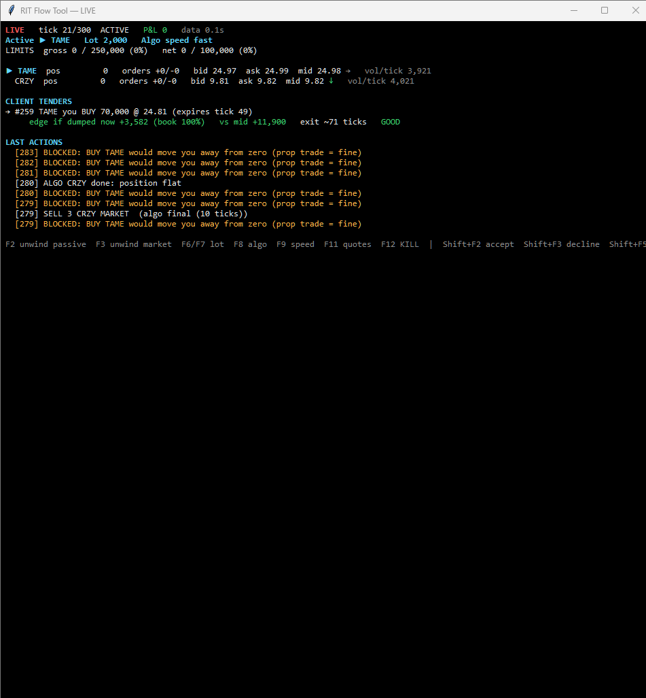
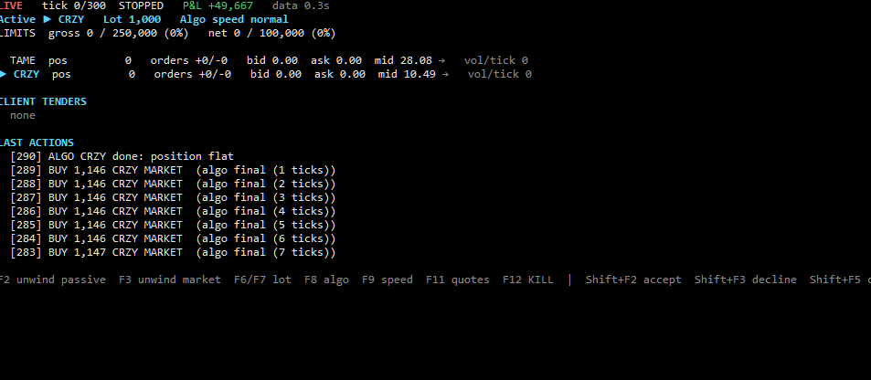
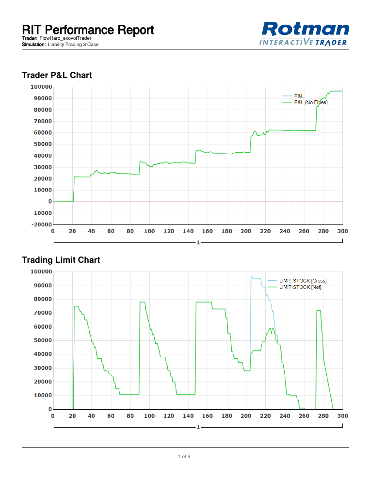
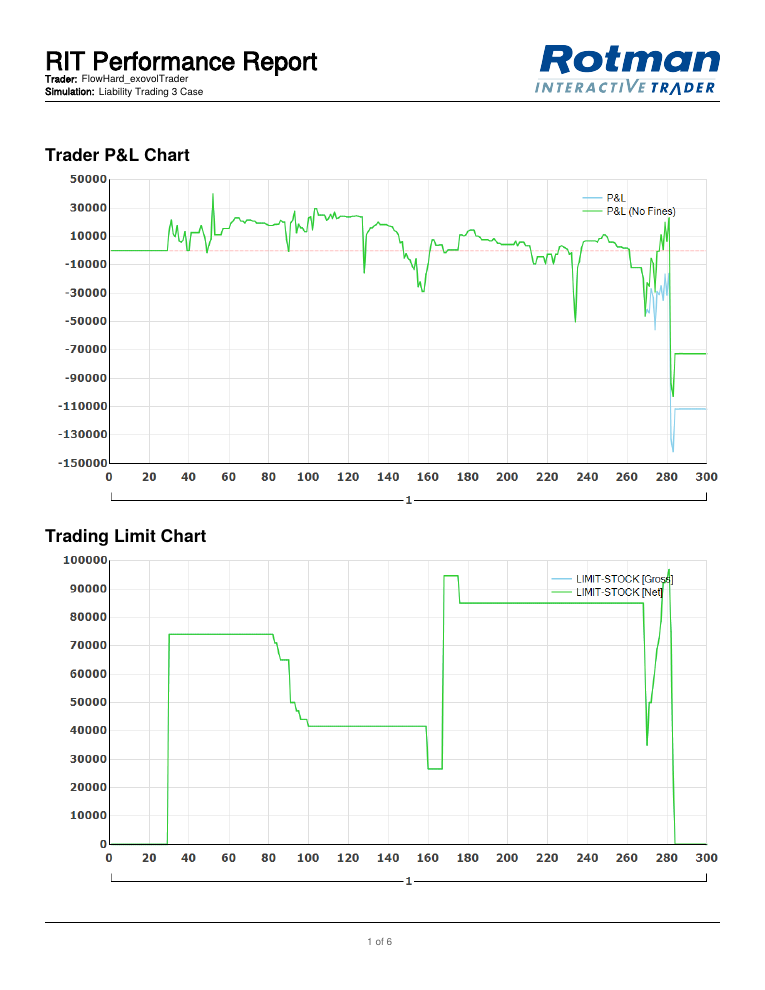
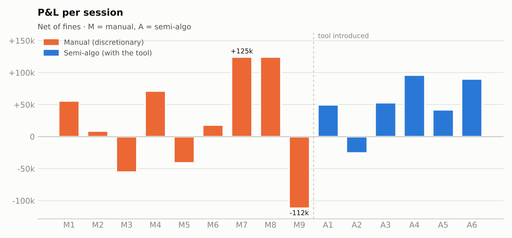
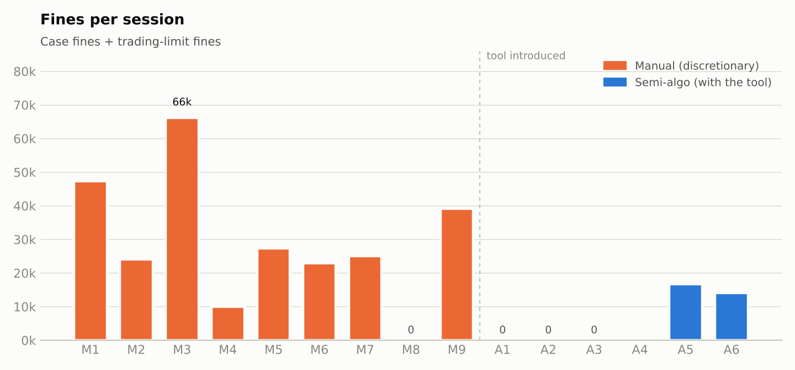

# Semi-Algo Execution Trading & Market Making

**A trader-in-the-loop execution tool for client liability flow, built and tested on the Rotman Interactive Trader (RIT) *Liability Trading 3* case.**

The trader decides which client trades to take. The tool prices each offer against the live order book, then unwinds the resulting position with a deadline-aware liquidation algo, passive limit orders and inventory-skewed quotes, while enforcing the risk rules that used to cost me money.

| | Manual phase (9 sessions) | Semi-algo phase (6 sessions) |
|---|---:|---:|
| Mean P&L per session (net of fines) | **+$21,637** | **+$50,911** |
| Mean fines per session | **$29,126** | **$5,170** |
| Worst session | −$111,712 | −$25,534 |
| Losing sessions | 3 of 9 | 1 of 6 |
| Mean / std. dev. of session P&L | 0.27 | **1.17** |
| Mean P&L **before** fines | +$50,763 | +$56,081 |

Every session with a saved RIT Performance Report is included, wins and losses. The raw reports are in [`reports/`](reports), the parsed dataset in [`data/sessions.csv`](data/sessions.csv).

> **What the last row says:** my edge on selecting client trades was roughly the same in both phases (~$51k vs ~$56k per session before fines). The tool did not make me a better picker of trades. It made me a far cleaner **executor**: fines fell by ~80%, the worst day shrank 4×, and the P&L-to-volatility ratio improved ~4×.



---

## 1. The case

RIT is a market simulator used for trading education and competitions. In *Liability Trading 3*:

- Two stocks trade in a continuous limit order book: **CRZY** (~$10) and **TAME** (~$25).
- A session lasts **300 ticks** (one tick ≈ one second).
- Around five times per session, a **client tender** arrives: an offer to buy from you or sell to you 65,000–75,000 shares at a fixed price, valid for a few ticks. Accept, and the position is yours to unwind in the market.
- Risk limits: **gross 250,000 / net 100,000 shares**. A tender that would breach them is rejected.
- **Case fines** are charged per share on trading that is not unwinding client flow, and any position left at the close is liquidated with a penalty.
- Commissions are charged on every share traded.



*The RIT client: a tender pop-up (top left: a client wants to buy 70,000 CRZY at 9.96), order entry, and the two ladders.*

This is a simplified version of a real sell-side job: a client hands the desk a block of risk, the desk takes it at a price, and its P&L depends on how cheaply it can work that block out of the book without moving the market against itself.

## 2. The problem

During my first sessions, done by hand in the RIT client, I kept losing money in the same three ways:

1. **Judging the tender.** A tender priced 20 cents through the mid looks great until you try to sell 70,000 shares into a book that only shows 15,000 at the top levels. I had no fast way to see the real exit cost.
2. **Execution under stress.** Near the close, with a large position left, I would send oversized market orders, cross the spread repeatedly and push the price against myself, or overshoot zero and pay fines on the way back.
3. **Discipline.** Stacking a second tender before the first was unwound, and relaxing the rules after a good day. My worst session (−$111,712, M9) came right after two days at +$124k.

## 3. The tool

[`src/rit_tool.py`](src/rit_tool.py) is a single Python file that talks to the RIT client through its local REST API. It runs next to the RIT window: a small always-on-top dashboard plus global hotkeys.



*A live tender: the client wants me to sell 70,000 CRZY at 9.96. Buying the shares back through the book right now would still leave +$2,387; against the mid the edge is +$7,000; exiting at 25% participation takes about 95 ticks. Verdict: GOOD.*



| Component | What it does |
|---|---|
| **Dashboard** | Positions, working orders, gross/net limit usage, bid/ask/mid with a trend arrow, volume per tick, the cost of dumping the position now, the close-out penalty if nothing is done, and estimated ticks to flat. |
| **Tender evaluator** | For each live tender: edge vs. mid, edge if unwound immediately by walking the book, book coverage, internalisation against the current position, time to exit, limit check, and a verdict. |
| **Liquidation algo** (F8) | Works the position to zero before tick 290 with child orders sized from the time left, mixing passive and aggressive orders, with urgency rising as the deadline nears. |
| **Unwind hotkeys** (F2/F3) | One lot toward zero, passive or at market. The direction is read from the live position, so a key can never add risk. |
| **Skewed quotes** (F11) | Passive quotes around the mid, shifted against the inventory so the side that reduces risk is the one that gets filled. |
| **Guardrails** | Reduce-only orders, confirmed cancels before re-posting, double press for large lots, market keys locked after a $50k loss, dry-run mode, and a CSV journal of every action and every tick. |



*Guardrails at work: with both books flat, manual buy keys are refused ("would move you away from zero"), so a stray keystroke cannot open an unhedged position that the case would fine.*



*End of a session: the algo finishes with market orders sized to land exactly on zero in the last ticks before the deadline.*

## 4. How I trade with it

The tool does not trade on its own. A typical session:

1. **A tender arrives.** I read the verdict line: edge vs. mid, edge if dumped now, whether the book can absorb it, and the time needed to exit. I only take tenders with a positive edge that I can exit before the close, and never one that stacks on an unfinished position unless it is in the opposite direction (shown as `MATCH`, which nets risk internally).
2. **I accept (Shift+F2) and start the algo immediately (F8)**, on a slow setting with small child orders. The earlier it starts, the more of the block it can work passively.
3. **I work the other ticker by hand.** While the algo unwinds CRZY, I can switch to TAME (Shift+F7) and unwind it with passive single-lot orders (F2), resting at the best price on my side of the book.
4. **I size down when the book is thin.** If 5,000- or 10,000-share lots stop filling, I drop to 2,000 or 1,000 (F6) so my orders do not reveal size or move the price.
5. **Early in the session I turn risk over quickly** to be ready for the next tender. A tender that arrives late is taken only if the book already pays more than the tender price, so it can be exited immediately at a profit; the algo then switches to fast (F9) and finishes with market orders in the last ten ticks.
6. **Flat before the close, every time.** No position is left to the close-out penalty.

The RIT report from my best semi-algo session (A4, +$96,339) shows the pattern. In the trading-limit chart (shares held), each tender is a vertical jump and each unwind a staircase down to zero, finished before the next tender arrives; the P&L steps up at every tender and holds while the block is worked out.



Compare with my worst manual session (M9, −$111,712), where positions were stacked and the exit came late:



## 5. The maths behind the tool

Notation: a tender asks me to trade $Q$ shares at price $P$, with direction $s = +1$ if I buy and $s = -1$ if I sell; $m$ is the mid price; $x$ my current position.

### 5.1 Pricing a tender against the book

The quoted edge against the mid is

$$\text{edge}_{\text{mid}} = s\,(m - P)\,Q .$$

It ignores that the block has to be exited through the book. To exit a long, I sell into the bids, walking down levels $(p_i, q_i)$ until $Q$ is filled. The average exit price is

$$\text{VWAP}(Q) = \frac{\sum_i p_i\, q_i}{\sum_i q_i}, \qquad \sum_i q_i = \min(Q, \text{depth}),$$

and the **immediate-exit edge** is $s\,(\text{VWAP}(Q) - P)\cdot Q_{\text{covered}}$. This is a pessimistic bound: it assumes the whole block is dumped now and that the book does not refill. If it is positive, the tender is profitable even in the worst execution. If only the mid edge is positive, the tender is worth taking only if it can be worked out patiently.

If the tender runs against my current position ($x \cdot s < 0$), the overlapping part $\min(Q, |x|)$ nets out internally: no market risk and no exit cost. Only the remainder has to go through the book.

**Feasibility.** With $\bar V$ the market volume per tick and $\pi$ the participation rate I can take without moving the price ($\pi = 25\%$), the exit needs about

$$T_{\text{need}} = \frac{Q}{\pi\,\bar V} \ \text{ticks},$$

which the evaluator compares with the ticks left before the deadline. The last check is whether gross and net positions after acceptance stay within limits.

### 5.2 The liquidation schedule

The benchmark is a **TWAP**: to liquidate $X$ shares over $T$ ticks at a constant rate,

$$r = \frac{X}{T}, \qquad x(t) = X\left(1 - \frac{t}{T}\right).$$

The **Almgren–Chriss** model generalises this. The trader minimises expected execution cost plus a penalty on its variance, $\mathbb{E}[C] + \lambda\,\mathrm{Var}[C]$, with temporary impact $\eta$ and volatility $\sigma$. The optimal holdings are

$$x(t) = X\,\frac{\sinh\big(\kappa (T - t)\big)}{\sinh(\kappa T)}, \qquad \kappa = \sqrt{\frac{\lambda \sigma^2}{\eta}} .$$

With no risk aversion ($\lambda \to 0$), this reduces to the linear TWAP. With more risk aversion, it front-loads the selling: you pay more impact to carry less inventory risk.

The tool uses a practical version of that trade-off, recomputed every tick:

1. **Child size** $c = \lceil \text{speed} \times |x| / T_{\text{left}} \rceil$, bounded below by 1,000 shares and above by the maximum order size. The speed setting (1.0 / 1.6 / 2.5) plays the role of risk aversion: higher means faster, front-loaded selling.
2. **Urgency** $\alpha = \text{clip}\big((60 - T_{\text{left}})/60,\ 0,\ 1\big)$ is the share of the child sent as a market order. It is zero for most of the session and rises linearly over the last 60 ticks.
3. **Trend adjustment:** if the mid has moved more than 3 cents against the position over the last 10 ticks, $\alpha$ increases by 0.3 (inventory risk is materialising). If it moves in my favour, $\alpha$ decreases by 0.3 and the algo waits for the market to come to it.
4. The rest of the child, $(1 - \alpha)c$, rests as a **passive limit order** at the best price on my side, one cent inside the spread when the spread is at least two cents.
5. In the **last 10 ticks** before the deadline, only market orders are sent, sized $|x| / T_{\text{left}}$ to land exactly on zero.

### 5.3 Why passive matters

Crossing the spread costs roughly half the spread plus market impact on every share. A resting limit order earns half the spread, at the risk of not being filled. On a 70,000-share block with a two-cent spread, the difference between all-aggressive and all-passive execution is about $1,400 before impact, and impact on thin levels is much larger. Across the semi-algo sessions, **77% of unwind volume was executed passively** (64%–83% per session).

### 5.4 Inventory-skewed quotes

In the **Avellaneda–Stoikov** market-making model, a dealer holding inventory $q$ quotes around a *reservation price* rather than the mid:

$$r(t) = S_t - q\,\gamma\,\sigma^2\,(T - t),$$

with total optimal spread

$$\delta^a + \delta^b = \gamma\,\sigma^2\,(T - t) + \frac{2}{\gamma}\ln\!\left(1 + \frac{\gamma}{k}\right),$$

where $\gamma$ is risk aversion and $k$ the decay of fill intensity with distance from the mid. A long dealer shades both quotes down, so its offer gets lifted more often and its bid less often, and the inventory mean-reverts toward zero.

The tool implements a linear, capped version: quotes at $m \pm 2$ cents, both shifted by $-1$ cent per 10,000 shares of position (capped at 5 cents), never crossing the opposite best. Because unwinding client flow is the only trading that is not fined in this case, quotes are **reduce-only**: only the side that moves the position toward zero is posted. Here the market-making logic serves as a passive exit, not as a source of new risk.

### 5.5 Invariants

The engine re-checks these before every order:

- **Never cross zero:** $\text{working reducing orders} + \text{new order} \le |x|$. This uses the live position and the open orders as reported by RIT, not the dashboard's cached copy.
- **Confirmed cancels:** before re-posting, the algo cancels its orders and polls RIT until the exchange confirms none are left. If an old order is still alive, its quantity is subtracted from the next child order.
- **Reduce-only manual keys:** F2/F3 choose the direction from the position and can only shrink it.
- **Limits:** a tender that would breach gross or net limits needs an explicit double press to accept.

## 6. Results





| Session | Phase | P&L (net) | Fines | Tenders won | Passive share |
|---|---|---:|---:|---:|---:|
| M1 | manual | +55,949 | 47,400 | 3 | — |
| M2 | manual | +8,831 | 24,080 | 2 | — |
| M3 | manual | −55,682 | 66,120 | 3 | — |
| M4 | manual | +71,279 | 10,034 | 4 | — |
| M5 | manual | −40,958 | 27,400 | 3 | — |
| M6 | manual | +17,950 | 23,000 | 1 | — |
| M7 | manual | +124,564 | 25,014 | 3 | — |
| M8 | manual | +124,511 | 0 | 4 | — |
| M9 | manual | −111,712 | 39,085 | 2 | — |
| A1 | semi-algo | +49,667 | 0 | 3 | 83% |
| A2 | semi-algo | −25,534 | 0 | 3 | 64% |
| A3 | semi-algo | +52,854 | 0 | 3 | 78% |
| A4 | semi-algo | +96,339 | 220 | 5 | 79% |
| A5 | semi-algo | +41,856 | 16,640 | 3 | 74% |
| A6 | semi-algo | +90,285 | 14,160 | 2 | 79% |
| **Total** | | **+500,198** | **293,153** | **44** | |

*Passive share is not comparable for the manual phase: those sessions often left positions to the end-of-case close-out, which the RIT report does not count as order volume.*

**Reading the results honestly:**

- **The gain comes from execution and risk, not from better trade selection.** Mean P&L before fines is similar across phases. What changed is what leaked out afterwards: fines, oversized market orders, positions left to the close.
- **Variance collapsed.** My manual phase includes my two best days (+$124k) and my worst (−$112k). The semi-algo phase is much tighter: standard deviation fell from $81k to $44k while the mean more than doubled.
- **It is a small sample.** Fifteen sessions in a simulated market are evidence of a process change, not a statistically robust backtest.

## 7. What went wrong and how it was fixed

Building the tool against a live simulator exposed real failure modes. Each one is a lesson that carries over to production execution systems.

| Session | Symptom | Root cause | Fix |
|---|---|---|---|
| Testing | Every passive limit order rejected with HTTP 500; market orders fine | The RIT client on a French-locale Windows parses prices with a decimal comma (`9,21`), and the tool was sending `9.21` | On the first 500, retry once with the other decimal separator and keep the format that works. Errors now show RIT's own message. |
| Testing | Unwind keys "blocked" while short | Separate buy/sell keys let me press the wrong side under stress; the reduce-only guard refused it | One unwind key per order type; direction comes from the position. |
| A1, A2 | Third tender rejected with `TRADING_LIMIT` | Me, stacking a tender on an unfinished position | Evaluator shows post-trade gross/net; breaching tenders need a double press. |
| A5 | 12,600 TAME bought past zero, then sold back: $16,640 in fines | Race condition: the algo cancelled and re-posted 50 ms later, and a resting order filled before the cancel landed, so old and new orders both executed | Confirmed cancels (poll until RIT reports no open orders) and subtract any surviving order from the next child order. |

## 8. Repository

```
├── src/rit_tool.py           # the tool: dashboard, tender evaluator, algo, hotkeys, journal
├── scripts/parse_reports.py  # RIT Performance Report PDFs -> data/sessions.csv, data/tenders.csv
├── scripts/make_charts.py    # data/sessions.csv -> figures/*.png
├── data/                     # parsed session and tender datasets
├── figures/                  # charts and report pages used in this README
└── reports/                  # the 15 original RIT Performance Reports (manual_XX, semialgo_XX)
```

### Run the tool

```bash
pip install -r requirements.txt
set RIT_API_KEY=YOUR_KEY          # Windows (or paste it into API_KEY at the top of the file)
python src/rit_tool.py
```

The RIT client must be open, logged in, and have its API enabled (port 9999). The tool starts in **dry-run mode** (`DRY_RUN = True`): it shows and logs every order without sending anything. Run a full session that way first, then set `DRY_RUN = False`.

### Hotkeys

| Key | Action |
|---|---|
| F2 / F3 | Unwind one lot toward zero: passive / at market |
| F6 / F7 | Lot size down / up (1k, 2k, 5k, 10k) |
| F8 | Liquidation algo on/off for the active ticker |
| F9 | Algo speed: slow / normal / fast |
| F11 | Inventory-skewed quotes on/off |
| F12 | Kill: stop everything and cancel all orders |
| Shift+F2 / Shift+F3 | Accept / decline the client tender |
| Shift+F5 | Cancel all my orders |
| Shift+F7 | Switch active ticker |

### Reproduce the figures

```bash
python scripts/parse_reports.py   # rebuilds data/ from reports/
python scripts/make_charts.py     # rebuilds figures/ from data/
```

## 9. Next steps

- **Calibrate the schedule** to the case instead of fixed constants: estimate temporary impact $\eta$ from the session journals and solve Almgren–Chriss for $\kappa$ directly.
- **Measure implementation shortfall** per tender from the CSV journal (arrival mid vs. realised exit price), split into spread, impact and timing.
- **A fill-probability model** for passive orders, to choose the passive/aggressive split from expected cost instead of a fixed urgency ramp.

---

*Kevin Amaru — Master Probability & Finance, Sorbonne Université. Built as practice for equity derivatives trading, where hedging a client's risk without paying away the margin in execution is the same problem at a larger scale.*

*RIT and Rotman Interactive Trader belong to the Rotman School of Management. This is an independent educational project.*
